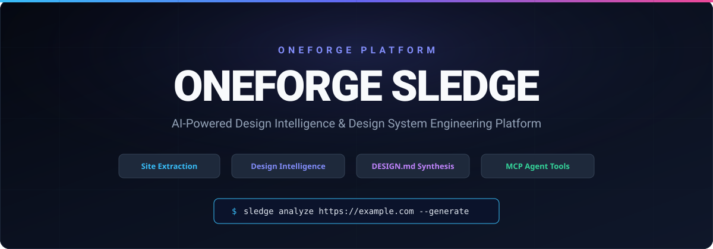
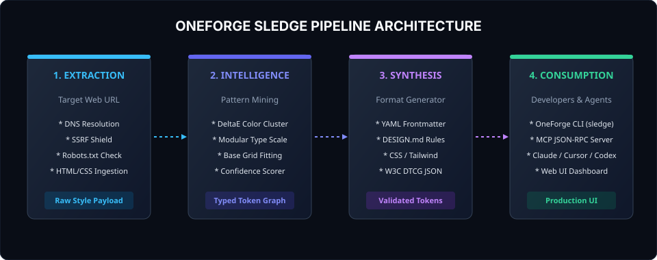

<p align="center">
  
</p>

<h1 align="center">OneForge Sledge</h1>

<p align="center">
  <b>AI-Powered Design Intelligence and Design System Engineering Platform</b><br>
  Discover, extract, analyze, synthesize, compare, and implement production-grade design systems for human engineers and autonomous AI coding agents.
</p>

<p align="center">
  <a href="LICENSE"></a>
  <a href="THIRD_PARTY_NOTICES.md"></a>
  <a href="https://nodejs.org">=20.0.0"></a>
  <a href="#mcp-server"></a>
  <a href="#test-suite"></a>
</p>

---

## Overview

**OneForge Sledge** is a comprehensive developer-grade platform that bridges the gap between web design systems, modern frontend development, and autonomous AI coding agents (Claude Code, Cursor, Codex, Windsurf, and Antigravity).

Rather than treating design systems as static screenshots or disconnected CSS files, OneForge Sledge treats them as **machine-readable, mathematically structured token graphs**:

1. **Design System Discovery**: Search, inspect, and filter 168+ verified production design systems across 11 industries.
2. **Safe Website Extraction**: Ingest live website styling with rigorous defense-in-depth against Server-Side Request Forgery (SSRF) and private IP tampering.
3. **Design Intelligence Engine**: Cluster colors using perceptual $\Delta E$ (CIELAB), deduce modular typography scales, detect base spacing rhythms, and assign quantitative confidence scores.
4. **Stitch-Compliant DESIGN.md Studio**: Generate specification-compliant plain-text design specifications optimized for autonomous AI coding agents.
5. **Multi-Format Token Exporters**: Compile tokens directly to CSS Custom Properties, Tailwind CSS presets, W3C DTCG standard JSON, and SCSS variables.
6. **Design System Comparison**: Compute side-by-side visual deltas, color palette overlaps, typography divergence, and overall similarity scores.
7. **Model Context Protocol (MCP) Server**: Full JSON-RPC 2.0 server supporting `stdio` and HTTP streaming transports for instant agent integration.
8. **Developer Interface & CLI**: Headless terminal binary (`sledge`) and a modern, high-density Web Dashboard.

---

## Architecture

<p align="center">
  
</p>

For comprehensive technical specifications, domain models, and security boundaries, see [ARCHITECTURE.md](ARCHITECTURE.md).

---

## Quickstart

### 1. Installation

```bash
# Clone the repository
git clone https://github.com/Cyrilthetecchieee/oneforge-sledge-.git
cd oneforge-sledge

# No external dependencies required! Uses native Node 20+ runtime capabilities.
npm test
```

### 2. Launch the Developer Web Dashboard

```bash
# Start the local server (Web UI + REST API + HTTP MCP)
npm start

# Or using the Sledge CLI
node bin/sledge.mjs serve --port=3456
```
Open **`http://localhost:3456`** in your browser to access the 11-panel Developer Dashboard.

---

## Command Line Interface (CLI)

The `sledge` CLI provides scriptable commands for developer workflows and CI/CD pipelines:

```bash
# Initialize a starter DESIGN.md in current directory
sledge init

# Search the catalog by brand name, category, or color
sledge search "Stripe" --theme=light
sledge search --category="Developer tools" --json
sledge search --color="#533AFD"

# Retrieve structured tokens for a brand
sledge get linear.app
sledge get stripe.com --json

# Extract raw styles from a live website
sledge extract https://example.com

# Run full design intelligence analysis on a live website
sledge analyze https://example.com

# Generate a validated DESIGN.md from a URL or brand
sledge generate https://example.com -o DESIGN.md
sledge generate stripe.com -o stripe-DESIGN.md

# Compare two design systems side-by-side
sledge compare stripe.com linear.app
sledge compare stripe.com linear.app --json

# Export tokens to CSS, Tailwind, DTCG JSON, or SCSS
sledge export stripe.com --format=css -o tokens.css
sledge export stripe.com --format=tailwind -o tailwind.config.js
sledge export stripe.com --format=dtcg -o tokens.json
sledge export stripe.com --format=scss -o _tokens.scss

# Validate a DESIGN.md file against schema specifications
sledge validate DESIGN.md

# Start the MCP server over stdio
sledge mcp
```

---

## AI Coding Agent Integration (Model Context Protocol)

OneForge Sledge implements the open **Model Context Protocol (MCP)** specification over standard I/O and HTTP.

### Connecting to Claude Code

Run in your terminal:
```bash
claude mcp add --transport stdio sledge "node ./bin/sledge.mjs mcp"
```

### Connecting to Cursor or Codex

Add OneForge Sledge to your MCP configuration file (`claude_desktop_config.json` or Cursor settings):

```json
{
  "mcpServers": {
    "oneforge-sledge": {
      "command": "node",
      "args": ["/absolute/path/to/oneforge-sledge/bin/sledge.mjs", "mcp"]
    }
  }
}
```

### Available MCP Tools

| Tool Name | Parameters | Description |
| :--- | :--- | :--- |
| `sledge_search_library` | `query`, `category`, `theme`, `color`, `limit` | Query 168+ design systems by brand, theme, or $\Delta E$ color match. |
| `sledge_get_design_system` | `host` | Retrieve complete structured tokens and DESIGN.md specification. |
| `sledge_analyze_website` | `url`, `skipRobots` | Safely extract and synthesize normalized tokens from a live URL. |
| `sledge_generate_design_md` | `url` or `host` | Synthesize a Stitch-compliant DESIGN.md document. |
| `sledge_compare_design_systems`| `systemA`, `systemB` | Compute visual delta, color distance, and typography overlap. |
| `sledge_export_tokens` | `host`, `format` | Export tokens to CSS Variables, Tailwind, DTCG JSON, or SCSS. |

---

## Security Engineering & Anti-SSRF Defense

OneForge Sledge enforces strict defensive measures for remote website ingestion:
- **SSRF Mitigation**: Hostnames are resolved through DNS lookup before connection. Requests resolving to loopback (`127.0.0.0/8`), RFC 1918 private subnets (`10.0.0.0/8`, `172.16.0.0/12`, `192.168.0.0/16`), Cloud Metadata (`169.254.169.254`), or link-local IPv6 (`fe80::/10`) are blocked immediately.
- **Redirect Pinning**: Every redirect hop is re-validated against the SSRF filter with a maximum depth limit.
- **Resource Bounds**: Strict 15-second wall-clock timeouts and 5 MB maximum payload limits prevent denial-of-service exhaustion.
- **Ethical Crawling**: Automated `robots.txt` policy verification is enabled by default.

For vulnerability reporting, see [SECURITY.md](SECURITY.md).

---

## Test Suite

The test suite runs with Node.js native test runner (`node:test`) with zero mock libraries or test bloat:

```bash
npm test
```

Passes 36/36 tests covering:
- Anti-SSRF IP filtering and hostname sanitization.
- Frontmatter parsing and schema validation.
- Perceptual color conversion and CIELAB DeltaE distance.
- Typography modular scale deduction.
- Spacing grid rhythm analysis.
- Multi-format token compilation (CSS, Tailwind, DTCG, SCSS).
- Model Context Protocol JSON-RPC 2.0 handshake and tool execution.
- CLI subprocess commands and HTTP server REST API.

---

## Documentation Index

- [ARCHITECTURE.md](ARCHITECTURE.md) — Comprehensive system architecture and domain models.
- [FEATURE_MATRIX.md](FEATURE_MATRIX.md) — Baseline vs Target capability matrix.
- [API_REFERENCE.md](API_REFERENCE.md) — REST API endpoints and MCP specification.
- [DEVELOPMENT.md](DEVELOPMENT.md) — Contributor developer setup and debugging.
- [DEPLOYMENT.md](DEPLOYMENT.md) — Production server deployment and Docker guide.
- [SECURITY.md](SECURITY.md) — Security policies and vulnerability disclosures.
- [CONTRIBUTING.md](CONTRIBUTING.md) — Coding conventions and pull request guidelines.
- [CHANGELOG.md](CHANGELOG.md) — Version release notes.
- [ROADMAP.md](ROADMAP.md) — Future product roadmap.
- [THIRD_PARTY_NOTICES.md](THIRD_PARTY_NOTICES.md) — Attribution and legal notices for adapted data.

---

## Licensing & Legal Attributions

- **Software Engine**: Copyright © 2026 OneForge. Licensed under the [Apache License, Version 2.0](LICENSE).
- **Adapted Design Dataset**: The baseline design records in `design-md/` are adapted from the Sitepeel DESIGN.md library under the Creative Commons Attribution 4.0 International License (CC BY 4.0). Required attribution: *"Sitepeel (sitepeel.dev) — https://sitepeel.dev"*. See [THIRD_PARTY_NOTICES.md](THIRD_PARTY_NOTICES.md).
- **Trademarks**: Third-party brand names and trademarks referenced are property of their respective owners. Design systems represent independent measurements of public websites and do not imply affiliation or official endorsement.
